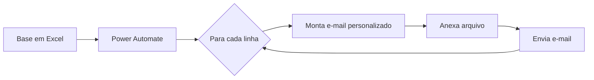

<p align="center">

</p>

<h1 align="center">Comunicações Automatizadas</h1>
<p align="center"><i>Envio de e-mails personalizados com anexos a partir de uma base em Excel</i></p>

<p align="center">


</p>

## Sumário

- [Sobre](#sobre)
- [Problema e solução](#problema-e-solução)
- [Funcionalidades](#funcionalidades)
- [Como funciona](#como-funciona)
- [Tecnologias](#tecnologias)
- [Benefícios](#benefícios)
- [Estrutura do repositório](#estrutura-do-repositório)
- [Autor](#autor)

## Sobre

Fluxo automatizado no **Power Automate** para envio de **comunicações personalizadas**. O fluxo lê uma base de dados em **Excel**, gera e envia **e-mails personalizados com anexos**, padronizando e automatizando a comunicação em larga escala.

> [!NOTE]
> Projeto desenvolvido em ambiente corporativo. O código-fonte e os dados não são publicados por conterem informações internas; este repositório documenta o problema, a solução e o funcionamento.

## Problema e solução

| | |
| --- | --- |
| **Problema** | Enviar comunicações individuais, com anexos, para muitos destinatários era um trabalho manual, demorado e sujeito a erros. |
| **Solução** | Um fluxo que percorre a base em Excel e monta cada e-mail automaticamente, com os dados e o anexo de cada destinatário. |

## Funcionalidades

- Leitura automatizada da base em Excel
- Personalização da mensagem para cada destinatário
- Envio de e-mails com anexos
- Padronização das comunicações em larga escala

## Como funciona



Detalhes: [Como funciona](docs/como-funciona.md)

## Tecnologias

| Tecnologia | Uso no projeto |
| --- | --- |
| Power Automate | Orquestração do fluxo |
| Excel | Base de destinatários e dados |
| E-mail | Canal de envio das comunicações |

## Benefícios

- Menos trabalho manual no envio
- Comunicação padronizada
- Escala sem aumento de esforço

## Estrutura do repositório

```text
power-automate-comunicacoes/
├── assets/
│   └── capa.png
├── docs/
│   └── como-funciona.md
└── README.md
```

## Autor

**Rodrigo Lemes** · Analista de TI · Microsoft 365, AD/Entra ID, Automação, Power BI e IA aplicada

[](https://www.linkedin.com/in/rodrigoalemes/)
[](https://github.com/rodrigoalemes)
